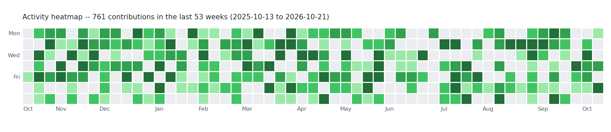

# Heatmap Calendar

A tiny demo/exercise project: turn daily activity counts into a
GitHub-style contribution heatmap PNG.



## What it does

`heatmap.py` takes a JSON file of `{date: count}` pairs (or generates
built-in demo data if you give it nothing) and renders a 53-week heatmap:
each column is a week, each row is a weekday, and cells are coloured in
five GitHub-style green intensity levels. Intensity levels are assigned
by quartiles of the non-zero values, so the scale adapts to whatever
data you feed it. Month labels run along the bottom, and the title
reports the total count and date range.

## How to run

```bash
python3 heatmap.py                    # demo data -> heatmap.png
python3 heatmap.py data.json          # your data -> heatmap.png
python3 heatmap.py data.json out.png  # your data -> out.png
```

`data.json` looks like this:

```json
{"2026-10-01": 4, "2026-10-02": 1, "2026-10-03": 0}
```

Missing dates count as zero; invalid entries are skipped with a warning;
anything outside the trailing 53-week window is ignored.

Requires Python 3.10+ and matplotlib (headless-safe: it uses the `Agg`
backend, so no display is needed).

## The idea behind it

Contribution graphs are one of the most recognisable data visualisations
on the web, but few people ever build one from scratch. This project
unpacks how they work: binning a date range into a week-by-week grid,
quantising raw counts into a small set of intensity levels via quartiles
(rather than fixed thresholds, so sparse and dense datasets both look
right), and laying out calendar metadata like month ticks and weekday
rows. It is a small, complete exercise in data wrangling and
visualisation -- no web framework, no API, just a script that turns
numbers into a picture.
